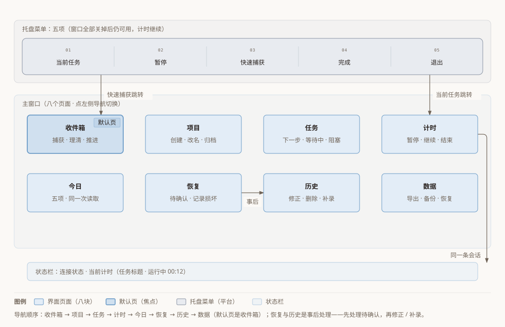
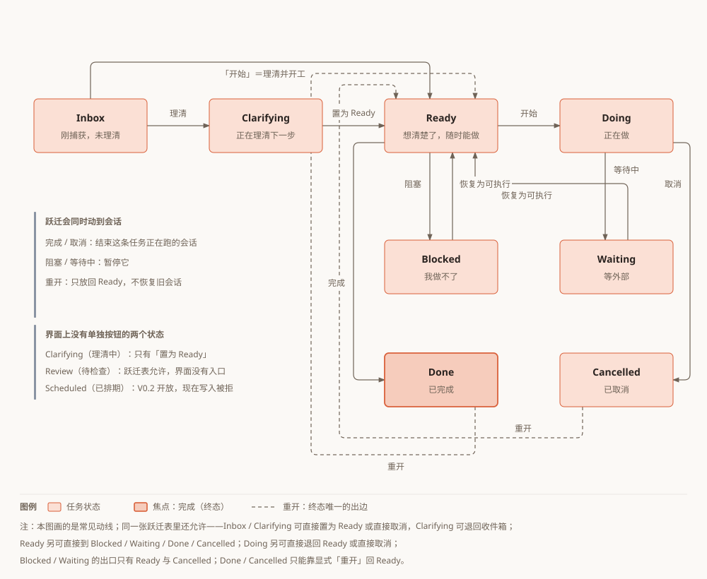
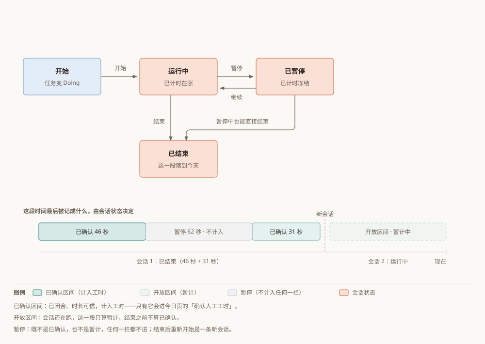
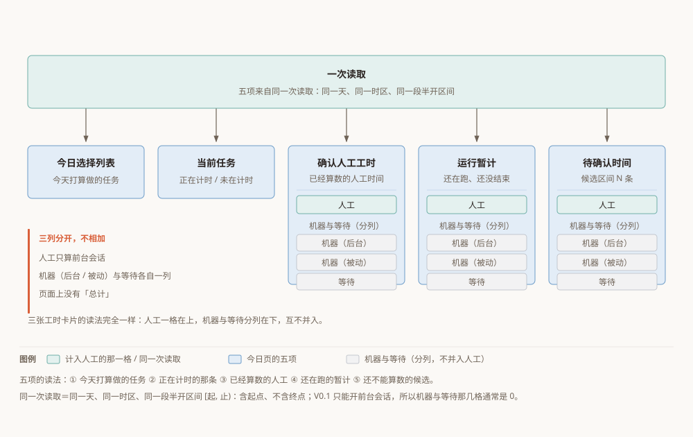
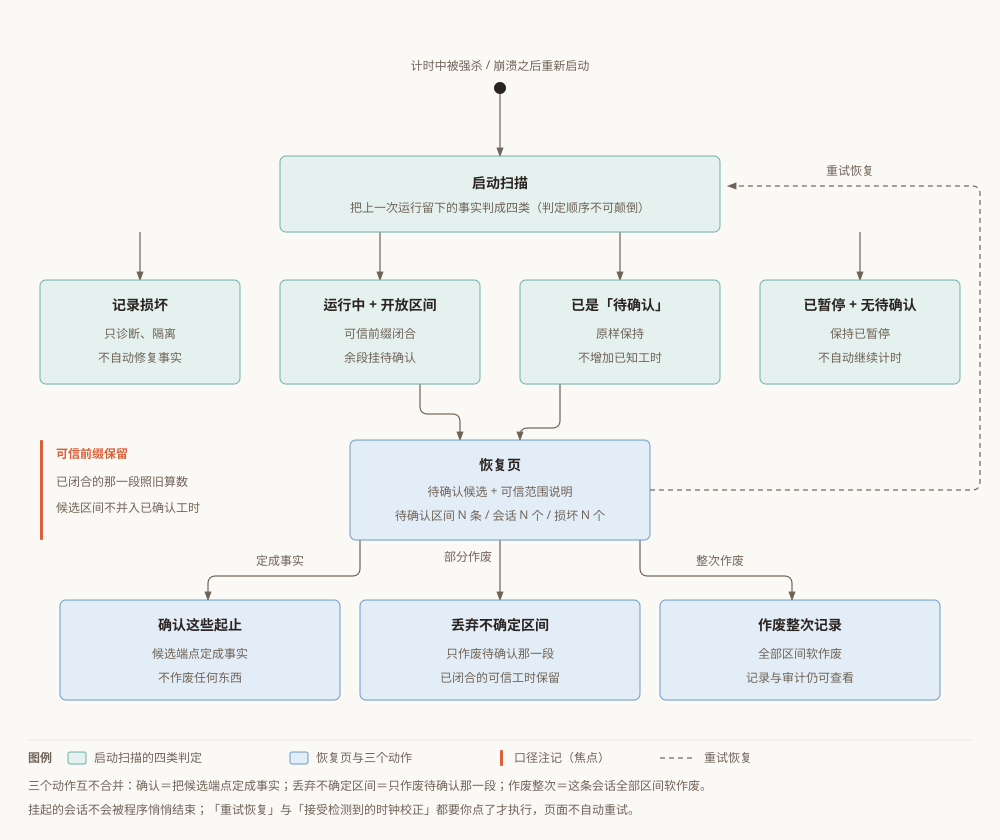
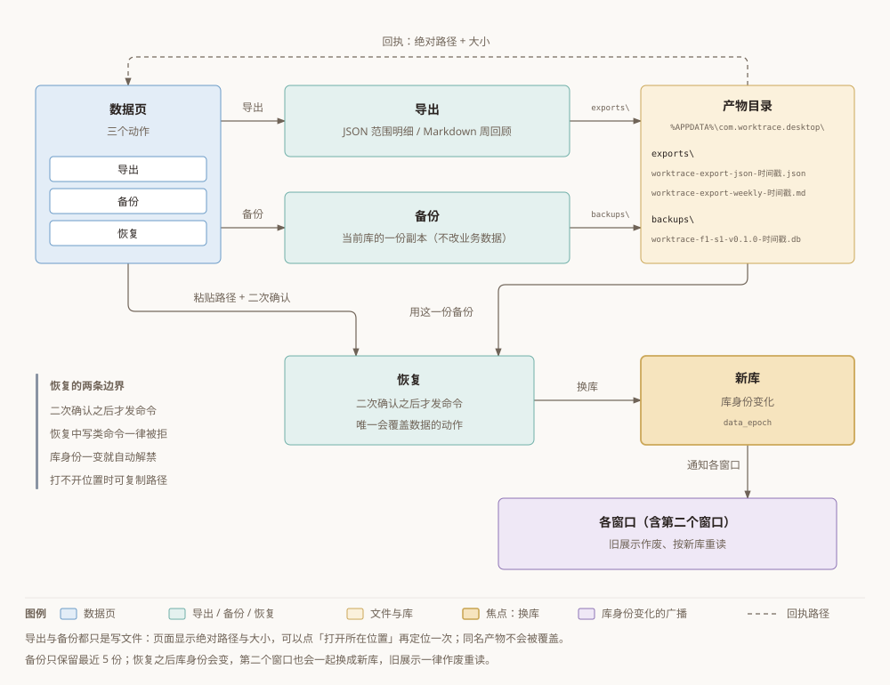

# Worktrace 使用说明书

> 适用版本：Worktrace 0.1.0（Windows 桌面版）。
> 本文面向**使用者**：只讲"你要做的事怎么做、做完看到什么"，不讲它是怎么实现的。

---

## 1. 这是什么

Worktrace 是一个装在你电脑上的个人工作记录工具：**干活前按一下「开始」，它替你把这段时间记下来；记错了你可以改，改过的痕迹它自己留着。**

它替你回答三个问题：

| 你想知道 | 它怎么答 | 去哪看 |
| --- | --- | --- |
| 时间花在哪了 | 每次计时都有起止和时长，按任务归拢；人工、机器、等待分列 | 计时、今日、历史 |
| 今天做了什么 | 今天选了哪些任务、现在在计时哪一条、今天确认了多少人工工时 | 今日 |
| 历史能不能改 | 能：补录漏记、修正起止、删除误记；每一笔改动都留审计 | 历史 |

三条口径先说在前面，后面会反复用到：

- **只有"已确认"的时间才算工时。** 程序异常退出后留下的不确定记录，会先挂成"待确认"，等你处理。
- **人工和机器不相加。** 人真正投入的时间、机器（后台/被动）跑的时间、等待的时间是三件不同的事实，界面上分列显示，没有"总计"这一栏。
- **删除是软删除。** 删掉只是"不再计入工时"，记录和审计都还在。

---

## 2. 安装与启动

1. 双击安装包 **`Worktrace_0.1.0_x64-setup.exe`**，按向导走完。
2. 它是**当前用户安装**：默认装到 `%LOCALAPPDATA%\Worktrace`（即 `C:\Users\<你的用户名>\AppData\Local\Worktrace`），不需要管理员权限。
3. 装完从安装目录启动 `Worktrace.exe`。**你之前的数据会保留**，安装不会清空它们。
4. 启动后你会看到主窗口，左上是 Worktrace 标题，底部状态栏显示连接状态；默认停在**「收件箱」**页。

**你的数据放在哪**

- 数据目录：`%APPDATA%\com.worktrace.desktop\`（即 `C:\Users\<你的用户名>\AppData\Roaming\com.worktrace.desktop\`）。
- 里面有数据库 `worktrace.db`、导出的 `exports\`、备份的 `backups\`。
- 全部数据都在你自己的电脑上，不联网也能用。

**单实例：重复启动不会开出第二个窗口**

Worktrace 同一时间只允许一个实例在跑。你再点一次图标（或双击 exe）：

- 主窗口还开着 → 它只把已有窗口抬到前台，**不会**再开一个窗口，也不会开出第二份计时；
- 主窗口已经被你关掉（进程还在，见 §10）→ 它会**重建**一个主窗口。

---

## 3. 界面导览

**八个页面**（点左侧导航切换）：

| 页面 | 是干什么的 |
| --- | --- |
| 收件箱 | 捕获一句话成任务，并把任务往前推：置为 Ready、开始、完成、取消、阻塞、等待中、重开 |
| 项目 | 创建 / 改名 / 归档项目；点项目名看它的任务列表，并新增行动 |
| 任务 | 三个列表分开看：**下一步行动**（Ready）、**等待中**（Waiting）、**阻塞**（Blocked）；可按项目、情境筛选，翻页 |
| 计时 | 看当前这一条会话：状态、已计时多久、待确认多久；在这里暂停 / 继续 / 结束 |
| 今日 | 你的日报视图：今日选择列表、当前任务、确认人工工时、运行暂计、待确认时间 |
| 恢复 | 处理"待确认"和"记录损坏"的记录（异常退出后通常来这里） |
| 历史 | 看已结束 / 已作废的会话与它们的时间区间；修正起止、删除误记、补录一段已经发生的时间 |
| 数据 | 导出（JSON 范围明细 / Markdown 周回顾）、备份、恢复 |

**底部状态栏**读两件事：

- `连接：已连接 / 连接中 / 连接失败 / 未连接` —— 界面和后台数据是否接上了；
- 当前计时 —— `任务标题 · 运行中 00:12`，没有在计时就不显示这一段。

**托盘菜单**（右键或左键点击任务栏托盘里的 Worktrace 图标），五项：

| 菜单项 | 做什么 |
| --- | --- |
| 当前任务 | 把窗口抬到前台并**切到「计时」页**（窗口已关就重建一个，直接落在计时页） |
| 暂停 | 暂停当前**正在运行**的那条会话 |
| 快速捕获 | 把窗口抬到前台、**切到「收件箱」页**，并把光标放进捕获输入框，可以直接打字 |
| 完成 | 把**当前正在计时的任务**置为完成 |
| 退出 | 正常退出程序（会做收尾；这是"真的关掉它"的方式，关窗口不是） |

两点要知道：托盘动作**没有回执**——成功了界面上不一定弹提示，以页面上的状态为准；**当前没有正在计时的会话时，点「暂停」或「完成」不会发生任何事**。

---

## 4. 日常主线：从一句话到一段工时

### 4.1 捕获：一句话进收件箱

1. 打开**「收件箱」**页。
2. 在顶部输入框里打一句话，例如 `整理下周评审材料`（输入框提示是"输入一句话，回车创建（项目可留空）"）。
3. 按 **回车**。

看到什么：列表顶部立刻出现这条任务，状态标签是 `Inbox`。不需要选项目、标签或日期；想让任务直接归到某个项目，可以在右边下拉里选一个（默认是「（无项目）」）。

注意：标题是空的（或只有空格）时不会创建，会提示"请输入任务标题。"

### 4.2 理清：把 Inbox 变成"下一步能做"

在收件箱这一行上点 **「置为 Ready」**。

看到什么：状态标签从 `Inbox` 变成 `Ready`。这就是"这件事我想清楚了，随时能做"。

### 4.3 开始计时

在收件箱那一行上点 **「开始」**。

看到什么：

- 任务状态变成 `Doing`，底部状态栏出现 `任务标题 · 运行中 00:00`，并开始走字；
- 「计时」页显示这条任务的标题、`运行中` 标签和"已计时 00:12"。

想直接开始也行：一条 `Inbox` 任务点「开始」，理清和开始会在同一步里完成，不会留下"理清了但没开始"的半截状态。

如果这条任务**已经在计时**，它的「开始」按钮是灰的（再点必然失败，所以干脆不给点）。

### 4.4 暂停 / 继续 / 结束

打开**「计时」**页，按钮按当前状态出现：

| 你做什么 | 点哪里 | 看到什么 |
| --- | --- | --- |
| 暂停 | 「暂停」 | 标签变 `已暂停`，已计时**冻结**在那一刻不再增长 |
| 继续 | 「继续」 | 标签回到 `运行中`，已计时接着涨；暂停的那段时间**不计入工时** |
| 结束 | 「结束」 | 标签变 `已结束`，操作按钮消失，这一段工时落到今天 |

「结束」在暂停状态也能点——**暂停之后直接结束是正常的一条路**。

暂停期间界面上的数字不动是设计如此，不是卡住了：真实的验收记录里，一次会话分成 46 秒和 31 秒两段，中间暂停了 62 秒，那 62 秒没有被算进去。

### 4.5 任务的其他出口

收件箱只列**还没结束**的任务（状态 `Inbox` / `Clarifying` / `Ready` / `Doing`），每一行按它的状态给出能点的按钮（不该点的不会出现）：

| 按钮 | 什么时候出现 | 做什么 |
| --- | --- | --- |
| 置为 Ready | 这条还是 `Inbox` / `Clarifying` | 理清成可执行 |
| 开始 | 这条还没被完成或取消 | 开始（或再开）一次计时 |
| 完成 | 这条已经理清（`Ready`）或正在做（`Doing`） | 任务完成 |
| 取消 | 这条还没被完成或取消 | 取消这条任务 |
| 阻塞 | 这条已经理清或正在做 | 标为被阻塞 |
| 等待中 | 这条已经理清或正在做 | 标为在等别人 / 别的事 |
| 重开 | 这条已经是 `Done` / `Cancelled` | 放回 `Ready`（**不会**恢复旧会话） |

**完成 / 取消会结束这条任务正在跑的会话；阻塞 / 等待中会暂停它。** 这不是换个标签而已——动作成功后页面顶部会弹一条回执，明确写出"结束了哪条会话"或"暂停了哪条会话"（例如：已把「整理评审材料」置为 Done；结束会话 8f3c…）。鼠标停在按钮上也会先看到这句影响说明。

两点补充：被标成阻塞或等待中的任务，收件箱里不再列出，去**「任务」**页的「阻塞」/「等待中」列表找，点 **「恢复为可执行」** 就回到 `Ready`；同样地，「重开」要等任务已经是完成/取消状态才出现，而这类行今天不会出现在收件箱列表里。

### 4.6 今日页怎么读

「今日」页显示五件事，都来自同一次读取，所以它们说的必然是同一个"今天"：

1. **今日选择列表** —— 你今天打算做的任务。从上面的下拉里选一条，点「加入今日」；不想要了点行尾的「移除」。下拉里只会出现还没加入的任务。
2. **当前任务** —— 现在挂在计时上的那条会话，以及它是不是真的在计时（`正在计时` / `未在计时`）；没有会话时显示"当前没有会话"。
3. **确认人工工时** —— 今天已经确认、真的算数的**人工**时间。
4. **运行暂计** —— 今天正在跑、还没结束的那一段（结束之前它不算进"已确认"）。
5. **待确认时间** —— 今天挂着的、还不能算数的时间，下面还会写"候选区间 N 条"。

页面顶部还标了口径：`按当前分类`、当天日期、时区、以及"区间（半开）[起, 止)"——半开的意思是**含起点、不含终点**，所以昨天 23:58 到今晚 00:02 的一段，两天各算各的那一部分。

**为什么人工和机器不能相加**：这三张卡片里，除了「人工」那一格，下面还有「机器（后台）」「机器（被动）」「等待」三格，标题写着"机器与等待（分列，不并入人工）"。它们量的是不同的事实——人投入的 1 小时，和机器自己在跑的 1 小时，加起来不等于"你工作了 2 小时"。所以界面上**没有总计**，别自己加。V0.1 里你只能开前台会话，所以机器和等待这两格通常是 `0`。

**"待确认"是什么意思**：那段时间有起点、但**终点没有被可信地记下来**（例如程序在计时中被强杀）。它不是工时，也不算进"确认人工工时"，要你去「恢复」页处理（见 §6）。

---

## 5. 修正历史

打开**「历史」**页。这里按开始时间升序列出**已经结束或已经作废**的会话，每页 50 条（页面顶部写明了范围）。

1. 点某一行右边的 **「打开详情」**。
2. 详情里能看到：会话 id、状态（`已结束` / `已丢弃`）、它属于哪条任务、会话的原始起止、版本号，下面是它的**区间**（每条带一个标签：`已确认` / `待确认` / `已作废`）和**审计**列表。
3. 用完点 **「关闭详情」**。

**修正起止（重定时）**

1. 只在**已结束**的会话、且这条区间是**已确认、未作废**时，才会出现两个输入框（提示里显示当前的起止，**不会预填**，避免你顺手提交一个并不是你本意的时刻）。
2. 按 `YYYY-MM-DD HH:MM` 填新的起点和终点。
3. 点 **「重定时」**。

看到什么：区间时长跟着变，审计里多一条记录，今日页的"确认人工工时"同步变化。如果新时间段和已有的某条区间撞上，会被拒绝，并告诉你和哪一段重叠——重叠的时间不能算两遍。

**删除误记（软删除）**

1. 在可修正的区间上点 **「删除误记」**。
2. 确认框写着"软删除：区间与审计都保留，只是不再计入工时。"，点 **「确认删除」**。

看到什么：这条区间标成 `已作废`，改时/删除入口消失（"已作废的区间不再计入工时，也不能再改。"），今日与周回顾里也不再计入。**记录本身和审计都留着**，导出里也还看得到它的存在。

**补录一段已经发生的时间**

在页面下方的「补录一段已经发生的时间」卡片里：

1. 选一条任务（下拉底部有「加载更多」，并显示"已列出 N / 共 M 条"，不会静默只给一页）。
2. 填起点和终点（`YYYY-MM-DD HH:MM`）。
3. 点 **「补录」**。

看到什么：历史里多一条**已结束**的会话，审计里有 `backfill`。补录**不会启动计时**，也不会伪造"完成"事件——它只是把已经发生的事补进账里。可以补过去的时间；同样不允许和已有区间重叠。

---

## 6. 异常与恢复

### 6.1 程序被强杀 / 崩溃之后

计时过程中程序被强制结束（任务管理器结束进程、断电、崩溃），下一次启动时：

- **已经闭合、可信的那一段照旧算数**，它仍然计入统计（这叫"可信前缀"）；
- 从最后一次可信记录到你重新打开程序之间的那一段，**终点不可信**，于是被挂成**待确认的候选**；
- 你会在**「恢复」**页看到计数：`待确认区间 N 条` / `待确认会话 N 个` / `记录损坏 N 个`，以及一条条的会话卡片。

被挂起的会话**不会**被程序悄悄结束掉，也不会被算进你的工时——它就在那里等你处理。今日页的"待确认时间"和它下面那句"候选区间 N 条"说的就是这件事。

### 6.2 恢复页三个动作的区别

卡片上要先填/选两件事，再点按钮：

- 输入框里的灰字（候选起点/候选终点）只是**提示**，不是已经确认的事实；要按 `YYYY-MM-DD HH:MM` 逐条填进真正的起止。
- 单选"对账之后这条会话停在："→ **已结束** 或 **暂停**。

| 动作 | 会作废什么 | 会保留什么 | 什么时候用 |
| --- | --- | --- | --- |
| **确认这些起止** | 不作废任何东西，把候选端点定成事实 | 你填的那段时间成为已确认的人工工时 | 你记得（或能合理判断）这段到底干了多久 |
| **丢弃不确定区间** | 只作废**待确认的那一段** | **此前已闭合的可信工时全部保留** | 那段时间说不清，宁可不要 |
| **作废整次记录** | 这条会话的**全部区间**都软作废，会话标为已作废 | 记录与审计仍可查看（但已作废的会话不能再修正/删除） | 整次记录都不该算数 |

界面上这三件事是三个不同的按钮，也**不许**当成一件事：页面上那句说明写得很直白——"丢弃不确定区间只作废上面这些待确认段：此前已闭合的可信工时保留，会话转为上面选的状态。"

「作废整次记录」会再弹一次确认框（标题"作废整次记录？"，确认按钮是「确认作废」），因为它影响的范围最大。

### 6.3 「重试恢复」与「接受检测到的时钟校正」

- **重试恢复**：计时不可用（故障态，或刚刚提交完还没刷新）时点它。成功后会提示"已重试恢复，计时状态已刷新。"；没有故障时点它也不会改变你的数据。
- **接受检测到的时钟校正**：系统时间发生过异常跳动时用它。**没有待接受的校正时，它会告诉你"当前没有待接受的时钟校正，库没有变化。"**——这是正常结果，不是报错。

两个动作都**只有你点了才会执行**：页面不会自动重试，也不会自动接受校正。

### 6.4 被导到恢复页是设计好的

如果你在别处做了一个动作，而系统认为"有未处理的计时记录，现在不能继续"，页面会**自动切到「恢复」页**，并在顶部带上原因（例如"存在待确认的计时记录，请先处理恢复再继续。"）。那句提示可以手动关掉，但它不会自己消失——它要让你知道"我为什么被扔到这一页"。处理完待确认记录，再回去做原来的事。

---

## 7. 导出与备份

打开**「数据」**页。页面顶部先告诉你这次导出用的是哪一天、哪个时区、哪一段半开区间，以及"已确认人工"是多少——**导出的数字和页面上显示的数字来自同一次统计**，不会各算各的。

### 7.1 导出 JSON 范围明细

1. 选中 **「JSON 范围明细」**。
2. 点 **「导出」**。

看到什么：出现"导出产物"，显示**绝对路径**（可一键复制）和"大小 N 字节"。JSON 里带的是上面那一段半开范围的明细。V0.1 **不提供"选择保存位置"**，路径固定在应用数据目录下的 `exports\`。

### 7.2 导出 Markdown 周回顾

1. 选中 **「Markdown 周回顾」**。
2. 点 **「导出」**。

看到什么：同样是路径 + 大小。周回顾按自然周汇总（周界由程序算，你不用传范围），文件名形如 `worktrace-export-weekly-<时间戳>.md`。

### 7.3 备份

点 **「备份」**。看到什么：出现"备份产物"和它的路径、大小。

备份只是**当前库的一份副本**（SQLite 文件），**不改动你的业务数据**——所以版本、统计都不会变，**这不是失败**。备份文件名形如 `worktrace-f1-s1-v0.1.0-<时间戳>.db`，放在 `backups\`。

一个要记住的限制：`backups\` 里**只保留最近的 5 份**，第 6 份进来时最旧的那一份会被自动清掉（刚写出的那一份不会被这次清理删掉）。想把某一份长期留着，**把它复制到别的地方**。

### 7.4 恢复（覆盖）

这是整个应用里**唯一会覆盖你数据的动作**，请读完再点。

1. 把一份备份产物的**绝对路径**粘贴进输入框（提示是"粘贴一份备份产物的绝对路径"）。
2. 点 **「恢复」**（没填路径时它是灰的）。
3. 确认框标题是"用这份备份覆盖当前数据？"，点 **「确认恢复」**；点「取消」则**一条命令都不会发出去**，也不会报错。

看到什么：提示"恢复完成，已切换到新库并刷新。"，输入框被清空，界面上的旧内容作废并重新读取。

务必知道三件事：

- **当前数据会被备份里的那一刻替换掉**。备份之后新记的内容不在备份里，恢复后就看不到了。
- **库身份会变**。用大白话说：恢复之后，界面上原来那份数据、以及正在飞回来的旧请求，全部作废重读；如果这时你开着第二个窗口，它也**会一起换成新库**（多个窗口不会各看各的库）。
- 备份文件如果不是有效的备份，恢复会被拒绝，**原库保持不动**，你还可以继续导出和计时。此时提示比较笼统（"存储暂时不可用，请稍后重试。"），不会明说"这不是有效备份"——看到这句话先检查你填的路径对不对。

### 7.5 「打开所在位置」

导出或备份成功后，会自动在文件管理器里定位到那个文件；想再打开一次，点产物那一行的 **「打开所在位置」**。它失败了会在页面上写出原因，并且可以重试（不会永久变灰）。产物路径本身一直显示、可复制，所以实在打不开时，把路径复制到文件管理器里也一样能找到。

---

## 8. 常见问题（FAQ）

**Q：为什么数字没变？**
几种常见情况：① 会话在**暂停**中——已计时是冻结的，不会涨；② 你刚做的是机器/等待的事，**人工那一格本来就不动**（三类不合并）；③ 这条记录被「删除误记」或「作废整次」处理过，**已作废不再计入工时**；④ 你点的是「备份」——备份不改业务数据，版本和统计都不该变。

**Q：为什么某条记录不能改？**
修正/删除只对**已结束**的会话、且**已确认且未作废**的区间开放。所以：区间标签是 `已作废` 的，页面上会写"已作废的区间不再计入工时，也不能再改。"；会话是 `已丢弃`（作废过）的，会写"已作废的会话不能修正起止或删除误记"；标着 `待确认` 的区间归恢复页处理。

**Q：为什么按钮是灰的？**
最常见的四种：① 还在**连接中**（状态栏显示"连接中"），这时页面上的输入与按钮一律禁用；② **正在恢复数据**（维护态）——数据页会显示"正在恢复：导出、备份与恢复暂时不可用（写类命令都会被拒），库身份一变即自动解禁。"，历史页与恢复页的写入入口同理；③ 上一条命令还在执行；④ 这个按钮对你**当前这条记录本来就不适用**——比如正在计时的那条任务上「开始」是灰的、「加入今日」没选任务时是灰的、「确认恢复」没填路径时是灰的、一条情境标签都没有时「情境」下拉是灰的。

**Q：重复启动为什么没反应？**
因为它是单实例：第二次启动只会把已有窗口抬到前台，然后自己退出。**要真关掉它，用托盘的「退出」。**

**Q：导出的文件在哪？**
在数据目录的 `exports\` 下（`%APPDATA%\com.worktrace.desktop\exports\`），文件名形如 `worktrace-export-json-<毫秒时间戳>.json` 或 `worktrace-export-weekly-<毫秒时间戳>.md`。页面上会显示完整绝对路径，也可以点「打开所在位置」直接定位。同名产物不会被覆盖。

**Q：「待确认」和「损坏」有什么区别？**
`待确认`说的是"**时间段的终点不可信**"——它只是一个候选，你给出起止（或丢掉它）就定案了，处理完就变成事实或作废。`记录损坏`说的是"**这条记录自身不一致**"，页面会写明"记录损坏，只作诊断、不自动修复：<原因>"，而且损坏的记录**不能通过确认修复**。两者都可能出现在恢复页，但一个能对账、一个只能诊断。

**Q：暂停中的会话算不算在计时？**
不算。暂停后已计时冻结、不再增长，暂停的那段时间也不计入任何工时；状态栏和计时页会一直显示 `已暂停`，只有点「继续」才会接着走。

**Q：我把窗口关了，计时还在跑吗？**
在跑。关掉主窗口**不等于**退出程序：进程还在，当前这段计时会继续，之后从托盘点「当前任务」或再启动一次都会把窗口弄回来（数据也在）。想让它停下来并收尾，用托盘的「退出」。

---

## 9. 数据与隐私

- **数据全部在本机**：`%APPDATA%\com.worktrace.desktop\`，数据库是 `worktrace.db`。不上传、不同步、不需要账号。
- **断网可用**：记录、统计、导出、备份、恢复都在本机完成，拔网线不影响使用（本轮验收没有单独做过"拔网线"这一步，但功能本身不依赖网络）。
- **备份文件就是 SQLite**：可以用别的只读工具打开查看；导出是 JSON / Markdown 明文，随时能自己核对。
- **删除是软删除**：记录与审计保留，只是不再计入工时；导出里也能看到它们的痕迹。
- **诊断日志不含业务正文**：出问题时留下的日志不会把你的任务内容写进去。

---

## 10. 已知边界

- **关窗 ≠ 退出**。点窗口右上角的关闭，窗口消失但程序还在（托盘图标还在、计时继续）。这是设计如此，不是没关掉。真退出用托盘「退出」。
- **最小化**。窗口被原生最小化期间，它不会一直去问数据有没有变；恢复显示时会立刻校验一次。浏览器层面的可见性切换没有单独测过，也**没有录屏**证明首屏绝无闪动——**首屏可能有极短暂的闪动，这一项尚未完成实机验证**。
- **托盘重建窗口**。主窗口关掉后再点托盘「当前任务」/「快速捕获」，重建出来的窗口会直接落在该去的页面（计时页 / 收件箱并聚焦输入框）。这一条在最新版本上已经实测通过；早前版本曾经丢失首次跳转，现版本已修复。
- **尚未完成实机验证**：真实锁屏、系统休眠/唤醒、手工修改系统时间，以及跨机器（≥2 台）的长期漂移校准（5 秒 / 8 小时量级）；真实断网也尚未单独验收。这些场景目前只有自动化测试覆盖，**不要当成已经保证的行为**。
- **界面入口的实机覆盖**：捕获 → 理清 → 开始 → 暂停 → 继续 → 结束、等待中 → 恢复为可执行、补录/修正/重叠拒绝/软删除、恢复页的三个动作、导出/周回顾/备份/恢复、托盘「退出」「当前任务」「快速捕获」都已经在真机上跑通过。相对地，托盘菜单里的**「暂停」与「完成」**、收件箱上的**「完成」「取消」「阻塞」「重开」**、以及项目详情里的**「新增行动」**，本次实机验收没有逐项点过（界面和规则都在，但请以实际动作为准）。
- **计时只有正计时**。V0.1 没有设置目标时长的入口，所以你不会看到"剩余/超时"；页面上的"剩余""超时"是给以后的目标时长准备的。
- **损坏或不存在的备份**：恢复会失败并保住原库，但提示语只说"存储暂时不可用，请稍后重试。"，不会明说文件本身有问题——按这个提示先核对路径。
